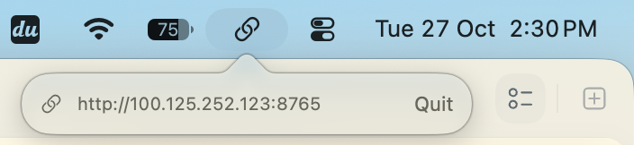
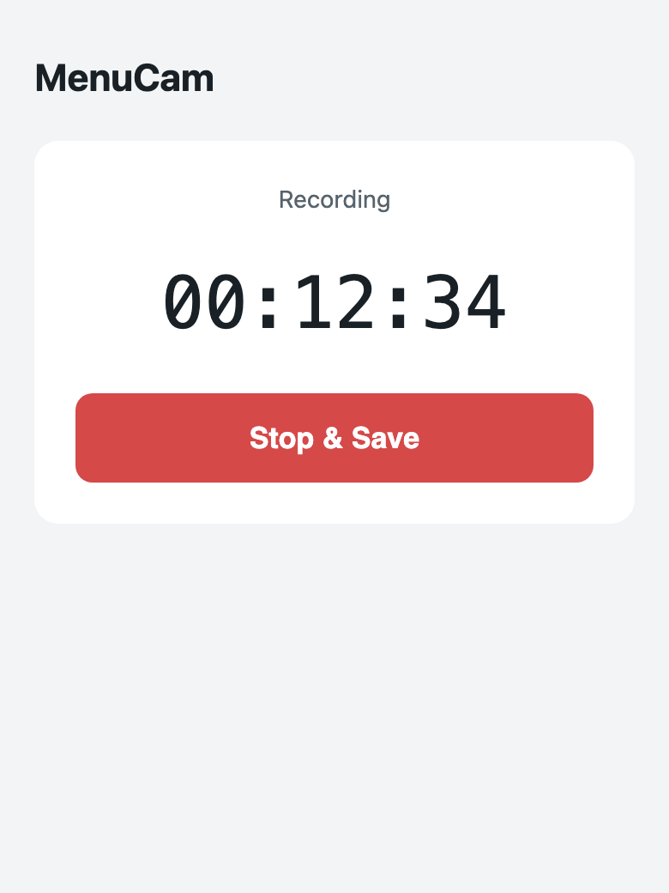
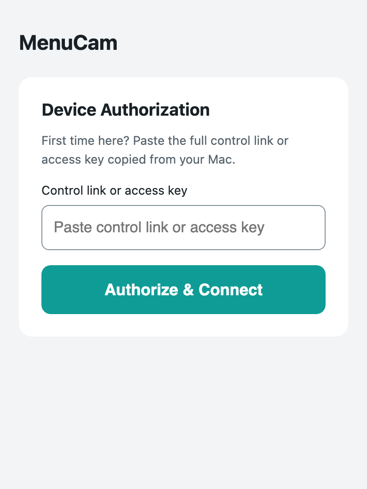
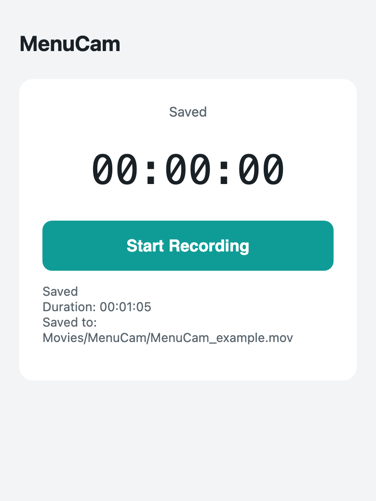

# MenuCam

A small macOS menu bar camera recorder with English UI and private Tailscale web control.

**[Download the latest Mac app](https://github.com/ethan6945/MenuCam/releases/latest)** · Apple Silicon · macOS 13+

## Screenshots

### Mac menu bar



### Web control and first-device authorization

 

### After saving



The menu bar image is the current Mac app screenshot. Web screenshots use demonstration data; no camera photos or access keys are shown.

## Get started

1. Download the ZIP, unzip it, and open `MenuCam.app`.
2. Allow camera access on the Mac; allow the microphone if you want audio.
3. Connect the Mac and phone to the same Tailscale network.
4. Click the MenuCam menu bar icon to see the control address.
5. Right-click the address, choose **Copy Control Link**, and open that full link on your phone.
6. If **Device Authorization** appears, paste the control link or access key and select **Authorize & Connect**.
7. Bookmark the full link for next time; the browser remembers authorized access.

## How to use

- **Open web control:** click the address in the Mac popover.
- **Start recording:** select **Start Recording** on the web page.
- **Stop from the web:** select **Stop & Save**.
- **Stop from the Mac:** press a keyboard key while blackout mode is active.
- **Take a current photo:** quickly tap the web timer three times, with less than 450 ms between taps.
- **Hide the photo:** tap the image once to clear it and show the timer again.
- **Take a photo while recording:** the existing video stream supplies the image; recording and timing continue uninterrupted.
- **Take a photo while idle:** the camera opens briefly for one photo, then closes; no recording or blackout starts.
- **Find a saved video:** read **Saved to** below the timer; the default path starts at `Movies/MenuCam/`.
- **Check the take length:** read **Duration** in the saved result; saving time is excluded.
- **Start another take:** the main timer resets to `00:00:00` after saving.
- **Quit the app:** select **Quit** in the Mac popover.

## What happens during recording

- Black windows cover the Mac screens.
- Supported display brightness is set to zero and automatic brightness is turned off.
- System audio output is muted and supported keyboard backlight is turned off.
- Stopping restores the original display, audio and keyboard settings.
- Closing the popover or stopping a take keeps the web server online.
- Photos stay in memory only; they are not saved as photo files or browser storage.
- Videos are saved locally as mirrored MOV files, with microphone audio when permitted.
- Camera startup black frames are skipped; cold camera photos may take several seconds.
- Browser tabs, bookmarks and phone home-screen shortcuts use the App's logo.
- Only one MenuCam instance runs, avoiding competing web servers.

## Requirements and access

- Apple Silicon Mac, macOS 13+, with a camera.
- Tailscale on both devices; allow TCP **8765** to the Mac in the tailnet ACLs.
- Both this Mac and the phone use the same Tailscale address.
- Full control links contain `#key=...`; treat them like passwords.
- The server binds only to Tailscale IPv4 `utun` addresses, not ordinary LAN or localhost.
- MenuCam does not configure port forwarding, Serve or Funnel. Keep the service inside the tailnet.
- The app is ad-hoc signed, not notarized; macOS may require an explicit Open confirmation.

## Build and test

Xcode Command Line Tools are required to build. No third-party packages or telemetry.

```sh
./build.command
./start.command
./verify.command
```

Optional checks:

```sh
./verify.command --hardware
./verify.command --blackout
```

Default tests use synthetic video/audio and separate test ports; Tailscale must be connected. They do not use the camera. `--hardware` briefly changes and restores actual brightness/audio settings. `--blackout` briefly covers the displays and tests keyboard recovery.

Validation includes authenticated HTTP/photo tests, mobile browser flows, real idle-camera capture, startup readiness, and four consecutive photos during one uninterrupted synthetic recording. The local workflow was accepted by the owner; individual hardware and OS combinations may behave differently.

## Settings and recovery

- Default recording folder: `~/Movies/MenuCam`; existing folder preferences are respected.
- Access key: `~/Library/Application Support/MenuCam/remote-key`, generated locally with file permissions `0600`.
- After a crash or force-quit, relaunch MenuCam to retry restoration from its local recovery journal.
- Brightness controls use private macOS interfaces; third-party displays may not support hardware dimming.
- System-reserved keys remain under macOS control; OS-owned dialogs follow system language settings.
- If the room is lit mainly by the screen, dimming it also makes the camera scene genuinely darker.

## HTTP API

All endpoints require `Authorization: Bearer <key>` and empty request bodies. Responses use `Cache-Control: no-store`; cross-origin requests are denied.

| Endpoint | Method | Purpose |
| --- | --- | --- |
| `/api/status` | GET | Read state and elapsed time |
| `/api/start` | POST | Start a take |
| `/api/stop` | POST | Stop and save |
| `/api/snapshot` | GET | Get one current JPEG, during recording or idle |
